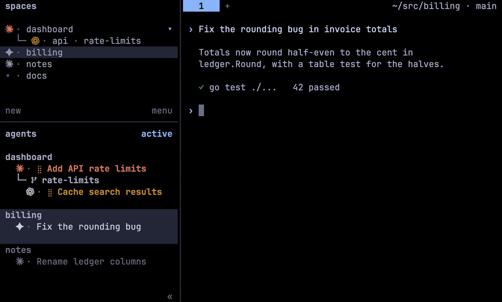

# Herdr Scope

<p align="center">
  <a href="https://github.com/kriuchkov/herdr-scope/actions/workflows/ci.yml"></a>
  
  
  <a href="LICENSE"></a>
</p>

<p align="center">
  <a href="#features">Features</a> •
  <a href="#install">Install</a> •
  <a href="#keys">Keys</a> •
  <a href="#configuration">Configuration</a> •
  <a href="#troubleshooting">Troubleshooting</a> •
  <a href="#development">Development</a> •
  <a href="#license">License</a>
</p>

A sidebar for [Herdr](https://herdr.dev) that shows which agent is working, which one waits on
you, and which finished while you were away. It only watches and paints: it never starts,
prompts or stops an agent.

## Features



- **State at a glance**: a spinner while an agent works, a red `?` when it asks, a green `✓`
  held until you look, and idle rows that fade with age.
- **Grouped by project**: worktrees and nested folders hang under their repository, and the
  busiest group comes first.
- **Vendor marks**: 27 agents, each with its own mark and colour, from the icon font or plain
  Unicode.
- **Jump**: `prefix+u` goes to the next agent waiting on you.
- **Fold and filter**: fold a folder to one line, or show only the workspace you are in.
- **Tab bar**: `?1 ✓2` before the path, and a waiting tab's name ends with its mark.
- **Settings popup**: every option is validated and applied without a restart.
- **Light**: one Go binary and one daemon per session. Nothing goes over the network.

| State | Row |
| --- | --- |
| working | braille spinner, title in the vendor's colour |
| waiting on you | red, the `?` pulses |
| done | green `✓`, until you focus the pane |
| idle | fresh → plain → stale; a stale row dims |

## Install

```sh
herdr plugin install kriuchkov/herdr-scope --ref release
```

The `release` branch carries prebuilt binaries for macOS, Linux and Windows. Without `--ref`,
Herdr builds from source, which needs Go 1.26+. Setup adds Scope's blocks to Herdr's
`config.toml` between `HERDR-SCOPE` markers and installs the icon font for your user. It
requires Herdr 0.9+ (protocol 22).

> [!IMPORTANT]
> If the sidebar has not changed, start the daemon:
> `herdr plugin action invoke kriuchkov.herdr-scope.state-start`.
> Never run `herdr server stop` to restart anything: it ends every pane.

To update, restart the daemon after updating the plugin. To uninstall, run these in order;
your `config.toml` comes back byte for byte:

```sh
herdr plugin update kriuchkov.herdr-scope                              # update
herdr plugin action invoke kriuchkov.herdr-scope.state-start

herdr plugin action invoke kriuchkov.herdr-scope.unconfigure           # uninstall
herdr plugin action invoke kriuchkov.herdr-scope.uninstall-font
herdr plugin uninstall kriuchkov.herdr-scope
```

## Keys

Scope binds no keys itself. `bin/herdr-scope configure --keys` prints the snippet for
`config.toml`, one `[[keys.command]]` per row:

| Key | Action | Does |
| --- | --- | --- |
| `prefix+u` | `jump` | the next agent waiting on you: questions first, then unseen results |
| `prefix+a` | `view-flip` | order: active ↔ recent |
| `prefix+f` | `view-here` | only this workspace ↔ all |
| `prefix+m` | `fold` | fold ↔ unfold this folder; agents waiting on you stay visible |
| `prefix+,` | `settings` | the settings popup |

```toml
[[keys.command]]
key = "prefix+u"
type = "plugin_action"
command = "kriuchkov.herdr-scope.jump"
```

## Configuration

`prefix+,` opens the popup: `↑↓` select, `←→` change, `s` save. A save is validated and
applied at once. The most used options:

| Option | Default | Values |
| --- | --- | --- |
| `layout` | `classic` | `classic` (`§ · ✓ title`) or `compact` (`§ ✓ title`, denser) |
| `order` | `active` | `active` by activity, `recent`, `here` (this workspace), `off` (Herdr's) |
| `variant` | `auto` | `font` icons, `text` (plain Unicode), `none`; `auto` picks what the terminal can draw |
| `show_age` | `waiting` | `? 4m`, `✓ 12m` on rows waiting on you; `all` or `off` |
| `done_hold` | `until_seen` | keep the `✓` until you look, or for a duration (`"30s"`) |
| `mark_tabs` | `true` | end a waiting tab's name with `?` or `✓` |
| `nest_folders` | `true` | hang a workspace opened inside another one's folder under it |

Every option and the file format are covered in [docs/configuration.md](docs/configuration.md).

## Troubleshooting

```sh
bin/herdr-scope doctor    # binary, protocol, socket, config, font, sidebar
bin/herdr-scope status    # daemon, connection, agents, last frame
```

- **Boxes instead of logos.** Ghostty and kitty draw the icons once the font is installed.
  iTerm2, Terminal.app and Windows Terminal need them in their own font:
  `herdr-scope font patch <font>.ttf`, then pick the `… Herdr` copy in the profile
  (`dist/JetBrainsMonoHerdr-Regular.ttf` is a ready-made one). Or set `variant = "text"`.
- **Rows unreadable on a light terminal.** Scope colours its rows for Herdr's theme, not for the
  desktop. Set a light theme: `[theme] name = "catppuccin-latte"`.
- **A block was skipped.** Your `config.toml` already declares `[theme.custom]` or
  `[ui.sidebar.*]`, and TOML allows a table only once. Merge them by hand.

The daemon logs to `scope.log` in the plugin's state directory. The log holds ids and
statuses, never prompts or titles. Like any Herdr plugin, Scope runs as you, unsandboxed.

## Development

```sh
make build     # bin/herdr-scope; the next state-start restarts the daemon on it
make race      # unit, contract and golden tests
make lint      # golangci-lint for darwin and windows
make golden    # rewrite tests/golden after an intended change to the look
```

From a checkout: `make build && herdr plugin link .` (`plugin link` runs no build step).
[Architecture](docs/architecture.md), [Herdr protocol notes](docs/protocol.md),
[design decisions](docs/design.md). `docs/demo/record.sh` re-records the GIF.

## License

MIT, see [LICENSE](LICENSE). The icon font is forked from qintmb/herdr-icon-agent-ui (MIT),
and vendor marks belong to their owners. Details are in
[THIRD_PARTY_NOTICES.md](THIRD_PARTY_NOTICES.md).
